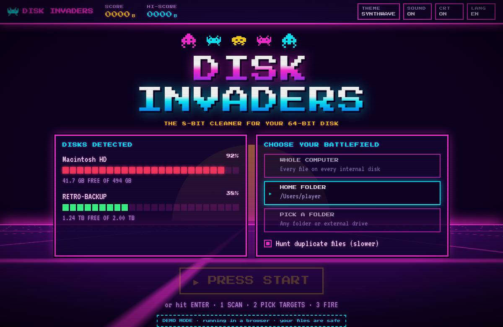
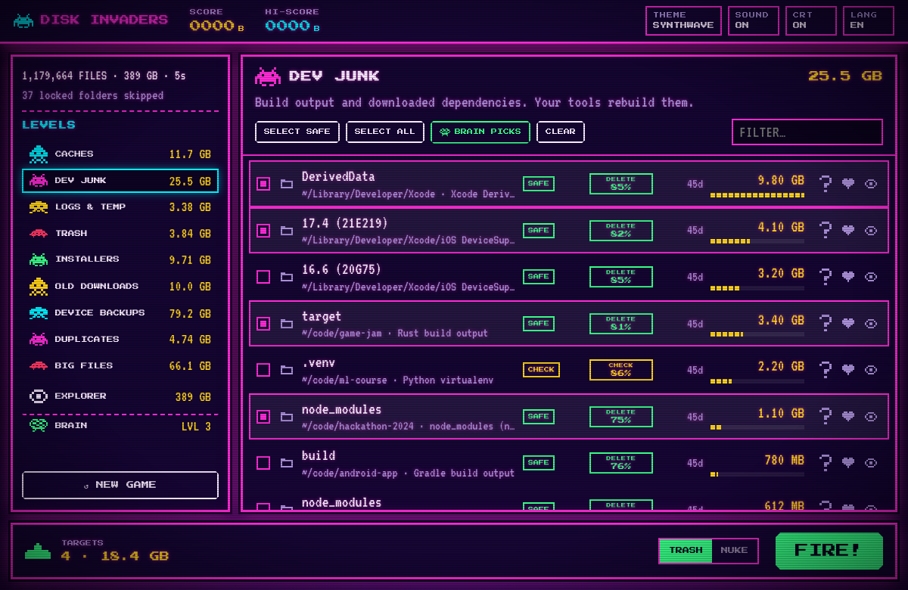
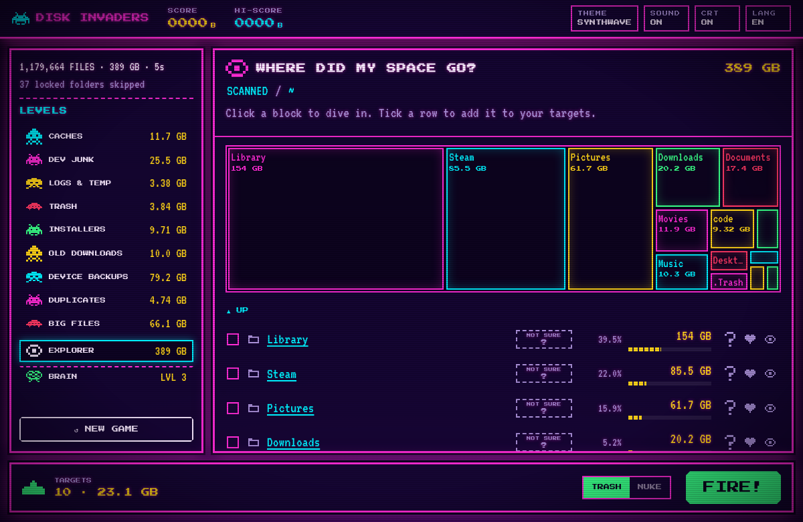
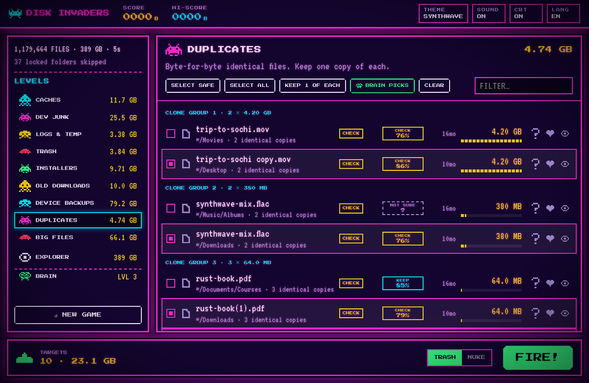
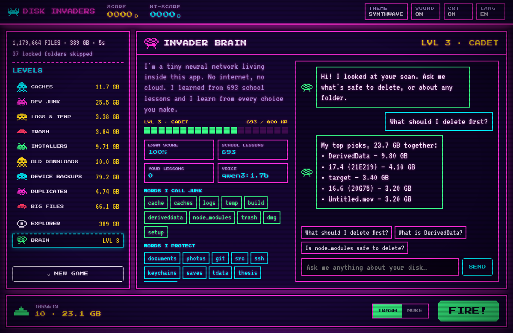
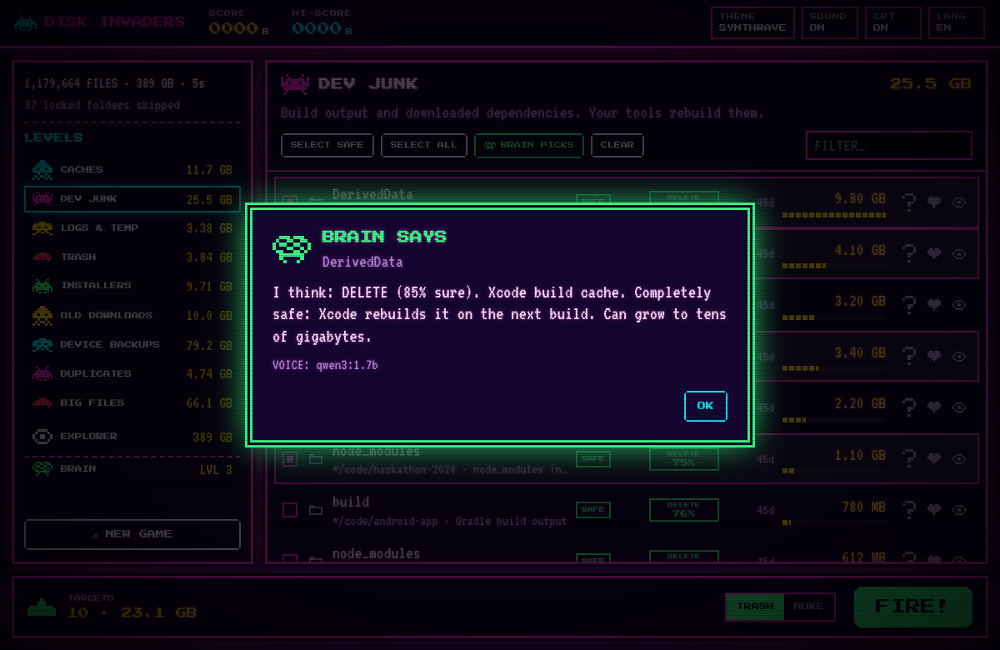
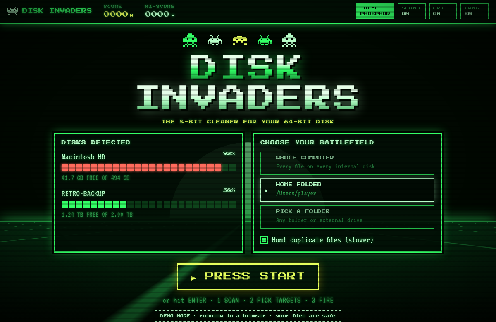
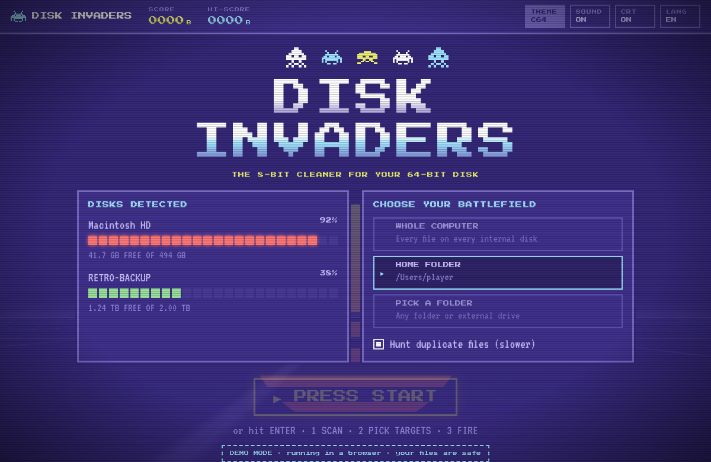

<p align="center"></p>

<h1 align="center">DISK INVADERS</h1>
<p align="center"><b>The 8-bit cleaner for your 64-bit disk.</b><br>
Find caches, build junk, forgotten downloads, duplicates and huge files on macOS &amp; Windows, then blast them away arcade-style.</p>

<p align="center"></p>

> 🇷🇺 [Читать на русском](README.ru.md)

## Why?

Disk cleaners are either paid, closed-source, or look like a tax form. Disk Invaders is free, open source, fast (Rust + Tauri, ~10 MB app) and fun: freed gigabytes are your **SCORE**.

## Features

- **Scans everything**: the whole computer, your home folder, or any folder/drive. Parallel Rust walker: hundreds of thousands of files per second.
- **9 levels of junk**: app caches, dev junk (`node_modules`, Rust `target`, Xcode DerivedData, Gradle, `.venv`…), logs &amp; crash dumps, Trash, installers (`.dmg`, `.pkg`, `.msi`, `.iso`), old downloads, iPhone backups, duplicates, big files.
- **Duplicate hunter**: size → partial hash → full BLAKE3 hash. Only byte-identical files are reported.
- **Explorer** with a treemap: "where did my space go?"
- **🧠 INVADER BRAIN**: a tiny neural network written from scratch (no ML libraries, no cloud) rates every item *delete / check / keep*, learns from every choice you make and levels up. Give it a free local **voice** (Ollama) and it chats about your disk. [How it works](docs/BRAIN.md).
- **Safe by design**: everything goes to the Trash by default (NUKE mode deletes forever). A Rust guard refuses system folders, your home folder, user folders, SSH keys and keychains, no matter what the UI asks.
- **Retro 80s look**: synthwave, green phosphor, amber and Commodore 64 themes, CRT scanlines, chip-tune sound effects, keyboard controls.
- **English and Russian** UI (add yours, it's one file).

| | |
|---|---|
|  |  |
|  |  |
|  |  |
|  |  |

## 📥 Install (no programming needed)

1. Open **[Releases](../../releases/latest)** and download the file for your computer:

   | Your computer | File to download |
   |---|---|
   | 🍎 Mac (Apple Silicon or Intel) | `Disk.Invaders_x.y.z_universal.dmg` |
   | 🪟 Windows 10 / 11 | `Disk.Invaders_x.y.z_x64-setup.exe` |

2. Install it:

<details>
<summary><b>🍎 macOS: step by step</b></summary>

1. Open the `.dmg` and drag **Disk Invaders** into **Applications**.
2. Start it from Applications. The app is not notarized by Apple yet, so the first time macOS says it *cannot verify the developer*:
   - click **Done**, then open **System Settings → Privacy &amp; Security**, scroll down and click **Open Anyway**;
   - or run once in Terminal: `xattr -dr com.apple.quarantine "/Applications/Disk Invaders.app"`
3. For a full scan, add the app in **System Settings → Privacy &amp; Security → Full Disk Access** and restart it.

</details>

<details>
<summary><b>🪟 Windows: step by step</b></summary>

1. Run the `-setup.exe` file.
2. If **"Windows protected your PC"** appears: click **More info → Run anyway** (the app is not signed yet).
3. Finish the installer and start **Disk Invaders** from the Start menu.

</details>

## 🛠 Build from source

Only if you want to change the code. Every command runs **in the project folder**, the one that contains `package.json`.

<details>
<summary><b>🍎 macOS</b></summary>

1. Install the tools (once):
   ```sh
   xcode-select --install                                          # Apple compilers
   curl --proto '=https' --tlsv1.2 -sSf https://sh.rustup.rs | sh  # Rust
   ```
   and [Node.js LTS](https://nodejs.org). Close and reopen Terminal.
2. Check: `node -v` and `cargo -V` both print a version.
3. Get the code and run it:
   ```sh
   git clone https://github.com/Fen1x678/disk-invaders.git
   cd disk-invaders
   npm install
   npm run app
   ```
   The first build takes 5–10 minutes, later ones are fast.
4. Make your own app: `npm run app:build` → `target/release/bundle/macos/Disk Invaders.app`

</details>

<details>
<summary><b>🪟 Windows</b></summary>

1. Install the tools (once):
   - [Node.js LTS](https://nodejs.org)
   - [Visual Studio Build Tools](https://visualstudio.microsoft.com/visual-cpp-build-tools/): tick **Desktop development with C++**
   - [Rust](https://rustup.rs): run `rustup-init.exe`, press Enter for the defaults
   - WebView2 is already part of Windows 10/11.

   Close and reopen the terminal.
2. Check: `node -v` and `cargo -V` both print a version.
3. Get the code and run it (a short path without spaces or non-Latin letters is safest):
   ```bat
   mkdir C:\dev
   cd C:\dev
   git clone https://github.com/Fen1x678/disk-invaders.git
   cd disk-invaders
   npm install
   npm run app
   ```
   No git? **Code → Download ZIP**, unzip it and `cd` into the folder that contains `package.json`
   (ZIPs often unpack as `disk-invaders-main\disk-invaders-main`).
4. Make your own installer: `npm run app:build` → `target\release\bundle\nsis\`

</details>

<details>
<summary><b>❓ Something went wrong</b></summary>

| Error | Fix |
|---|---|
| `Could not read package.json` / `ENOENT` | You are in the wrong folder. `cd` into the one with `package.json` (`dir` / `ls` to check). |
| `tauri: command not found` / `'tauri' is not recognized` | Run `npm install` first. |
| `cargo: command not found` / `'cargo' is not recognized` | Install Rust, then **reopen** the terminal. |
| `link.exe not found` (Windows) | Install Visual Studio Build Tools with **Desktop development with C++**. |
| `requires rustc 1.xx` | `rustup update` |
| Empty window | You opened the dev build directly. Use `npm run app`, or build the real app with `npm run app:build`. |

</details>

**Other ways to play:**

- **Browser demo, no Rust:** `npm install`, then `npm run dev` (a fake disk).
- **Scanner only:** `cargo run --release -p invaders-core --example scan -- ~/`
- **Brain only:** `cargo run --release -p invaders-core --example brain` (it takes its final exam)

## How it works

```
src/                    TypeScript UI (no framework, ~2k lines)
  screens/              title, scan and results screens
  api.ts / mock.ts      bridge to Rust / fake backend for the browser demo
  i18n.ts               all UI strings
  styles/main.css       themes are just CSS variables
src-tauri/              the desktop shell (Tauri 2): commands the UI calls
crates/core/            the engine, plain Rust, fully unit-tested
  scanner.rs            parallel walk, size tree, junk detection
  rules.rs              junk rules  ← easiest place to contribute
  dupes.rs              duplicate finder
  safety.rs             what may never be deleted
  delete.rs             Trash / permanent delete
  brain/                the neural network, from scratch
  voice.rs              talks to a local language model (Ollama)
brain/                  what the brain learns from  ← teach it with a PR
  dataset.csv           school book (labeled examples)
  exam.csv              final exam (never trained on)
  knowledge.json        plain-language knowledge cards (EN/RU)
```

## Roadmap

- 🧠 **Invader-1.7B**: fine-tune the brain's voice on Disk Invaders knowledge and publish it as our own open model. See [BRAIN.md](docs/BRAIN.md#next-level-an-invader-model-of-our-own).
- Achievements, sorting, an "Empty Trash" button, NTFS MFT turbo scan on Windows: see [good first issues](docs/GOOD_FIRST_ISSUES.md).

## Contributing

PRs are very welcome, including your first one. See [CONTRIBUTING.md](CONTRIBUTING.md) and [good first issues](docs/GOOD_FIRST_ISSUES.md). Popular starters: **teach the brain** (add lessons to `brain/dataset.csv`), a new junk rule, a new theme, a new language.

## License

[MIT](LICENSE)
