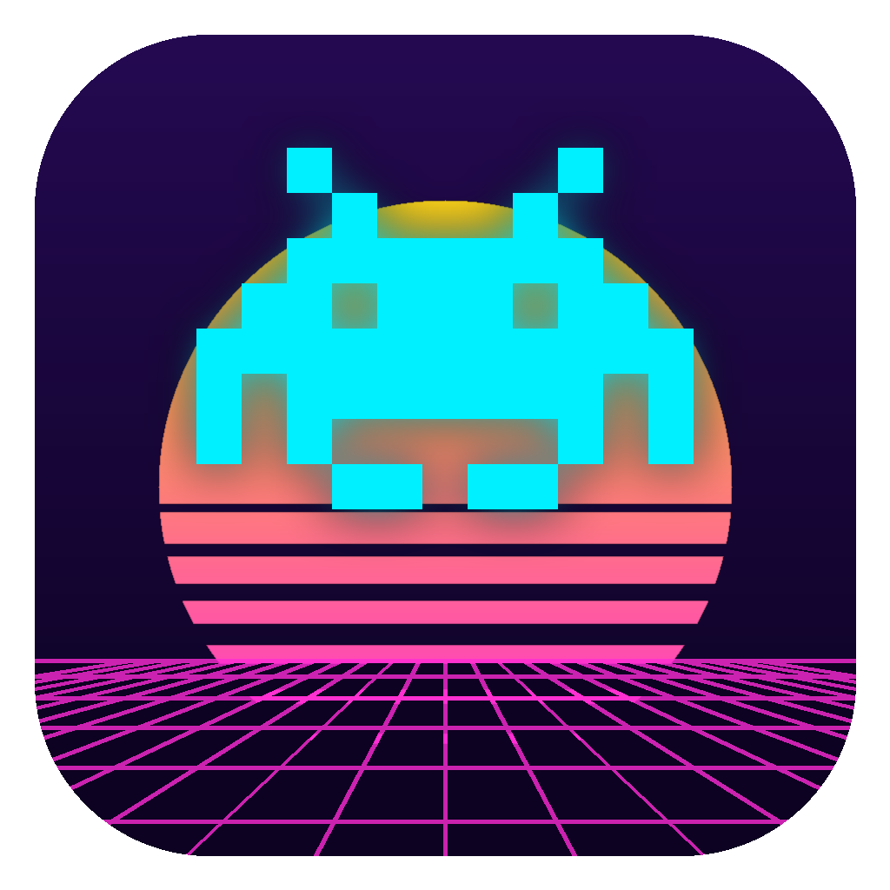
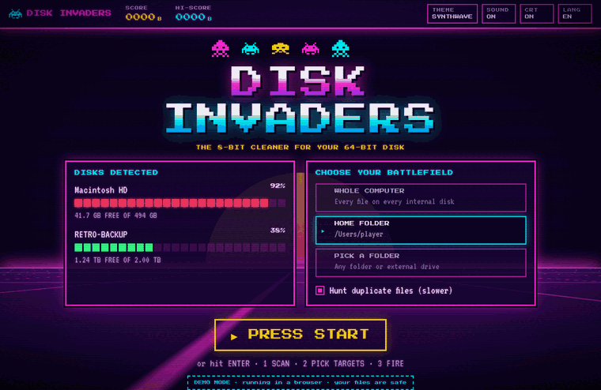

<p align="center"></p>

<h1 align="center">DISK INVADERS</h1>
<p align="center"><b>8-битный чистильщик для 64-битного диска.</b><br>
Находит кэши, мусор от сборок, старые загрузки, дубликаты и огромные файлы на macOS и Windows — и уничтожает их в стиле аркады 80-х.</p>

<p align="center"></p>

## Возможности

- **Сканирует всё**: весь компьютер, домашнюю папку или любую папку/диск. Параллельный обход на Rust.
- **9 уровней мусора**: кэш приложений, дев-мусор (`node_modules`, `target`, Xcode DerivedData, Gradle, `.venv`…), логи и дампы, Корзина, установщики, старые загрузки, бэкапы iPhone, дубликаты, большие файлы.
- **Поиск дубликатов**: размер → частичный хэш → полный BLAKE3. Только побайтово одинаковые файлы.
- **Проводник** с treemap-картой: «куда делось место?»
- **🧠 МОЗГ ЗАХВАТЧИКОВ**: маленькая нейросеть, написанная с нуля (без ML-библиотек и облаков), оценивает каждую находку «удалить / проверить / оставить», учится на каждом вашем решении и растёт в уровнях. С бесплатным локальным **голосом** (Ollama) она ещё и общается про ваш диск. [Как это устроено](docs/BRAIN.md).
- **Безопасность**: по умолчанию всё уходит в Корзину (режим «НАВСЕГДА» — без возврата). Rust-модуль защиты не даст удалить системные папки, домашнюю папку, «Документы» и т.п., SSH-ключи и связки ключей.
- **Ретро-дизайн 80-х**: темы synthwave, зелёный фосфор, янтарь и Commodore 64, эффект ЭЛТ-монитора, 8-битные звуки.
- Интерфейс на **русском и английском**.

## Сборка

Нужны [Node.js 20+](https://nodejs.org), [Rust 1.90+](https://rustup.rs) и [зависимости Tauri](https://v2.tauri.app/start/prerequisites/).

```sh
npm install
npm run app          # запуск приложения в режиме разработки
npm run app:build    # сборка установщика (target/release/bundle)
npm run dev          # только интерфейс в браузере, демо-режим с фейковым диском
cargo test -p invaders-core   # тесты ядра
```

## Планы

- 🧠 **Invader-1.7B**: дообучить голос мозга на знаниях Disk Invaders и выложить как свою открытую модель. См. [BRAIN.md](docs/BRAIN.md).

## Научить мозг

Добавьте примеры в `brain/dataset.csv` (`путь,file|dir,размер_МБ,возраст_дней,delete|review|keep`) или нажмите в приложении **ВЫГРУЗИТЬ МОИ УРОКИ** и пришлите файл в pull request. CI проверит, что мозг сдаёт экзамен (`brain/exam.csv`) не хуже 85%.

## Участие

Pull request'ы приветствуются, в том числе первые в жизни. См. [CONTRIBUTING.md](CONTRIBUTING.md) и [задачи для новичков](docs/GOOD_FIRST_ISSUES.md).

Лицензия: [MIT](LICENSE)
