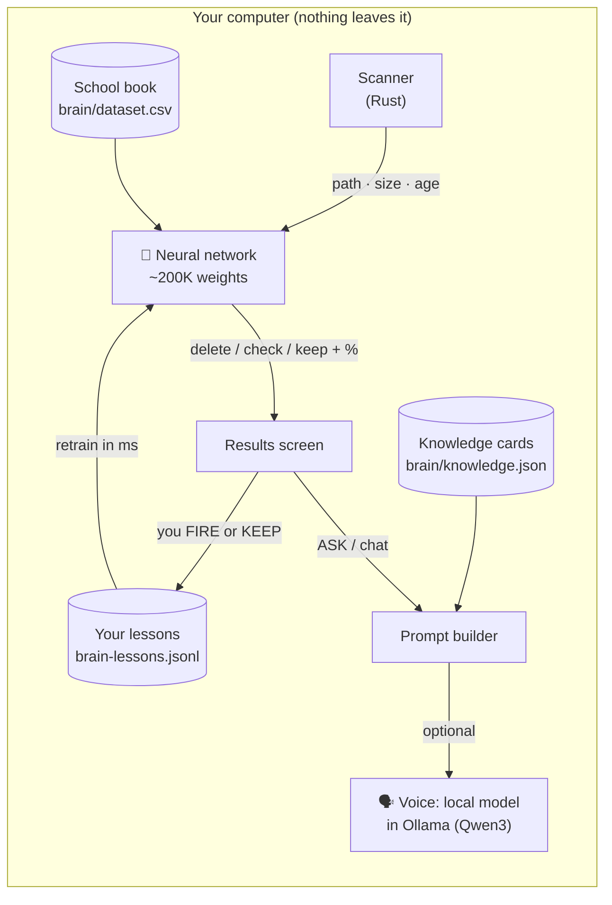
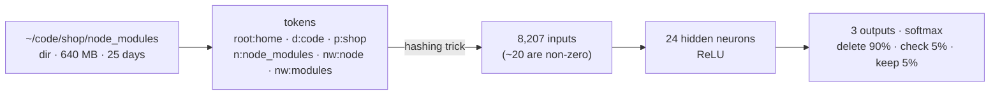
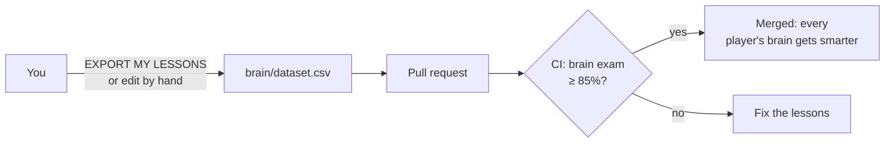

# 🧠 INVADER BRAIN

A tiny neural network that lives inside Disk Invaders, written from scratch in Rust: no ML libraries, no cloud, no API keys.
It looks at every item the scanner finds and says **delete**, **check** or **keep**, and it learns from every choice you make.
With an optional free *voice* (a small open-source language model running locally), it can also chat and explain.

## How it fits together

| Part | Where | What it does |
|---|---|---|
| Features | [`crates/core/src/brain/features.rs`](../crates/core/src/brain/features.rs) | Turns a path into numbers: words of the path (hashed), size, age, depth |
| Network | [`crates/core/src/brain/net.rs`](../crates/core/src/brain/net.rs) | 2-layer perceptron + backpropagation, ~150 lines |
| Brain | [`crates/core/src/brain/mod.rs`](../crates/core/src/brain/mod.rs) | Training, memory of your choices, levels, exam |
| School book | [`brain/dataset.csv`](../brain/dataset.csv) | Labeled examples. **Anyone can improve it with a PR** |
| Final exam | [`brain/exam.csv`](../brain/exam.csv) | Paths the brain never trains on. Its score is honest |
| Knowledge | [`brain/knowledge.json`](../brain/knowledge.json) | Plain-language explanations of common folders (EN + RU) |
| Voice | [`crates/core/src/voice.rs`](../crates/core/src/voice.rs) | Talks to Ollama with the standard library only |

## The network

- **Input.** Every word of the path becomes a token tagged with where it appears (`n:` the item's own name, `p:` its parent, `d:` deeper folders, `ext:` the extension, `c:` the folder name wherever it is). Tokens are hashed into 8,192 slots (the *hashing trick*: no dictionary, any new word just works). 15 more numbers describe size, age and depth.
- **Training.** Stochastic gradient descent with backpropagation, cross-entropy loss, label smoothing (so it stays humble), weight decay, class balancing and data augmentation (each lesson is shown again with a different size, so names matter more than bytes). 30 epochs over ~1,400 examples take about 20 ms.
- **Memory.** Anything you explicitly kept or deleted is remembered exactly (★ in the UI) and also generalizes to similar paths.
- **Honesty.** Below 60% confidence the brain says *NOT SURE*. It is an extra opinion; the scanner's rules and the safety Guard still decide what may be deleted.

## Levels

XP = school lessons + 10 × your lessons. Levels go from **NEWBORN** to **GALAXY BRAIN**:

| Level | XP | Title |
|---|---|---|
| 1 | 0 | NEWBORN |
| 2 | 250 | LARVA |
| 3 | 500 | CADET |
| 4 | 800 | SCOUT |
| 5 | 1,200 | PILOT |
| … | … | … |
| 12 | 10,000 | GALAXY BRAIN |

## The voice (optional, free, offline)

The brain sorts junk on its own. To *talk*, it needs a small language model:

1. Install [Ollama](https://ollama.com/download) (free).
2. In Disk Invaders open **BRAIN → CHOOSE A VOICE** and download one:

| Voice | Model | Size | License |
|---|---|---|---|
| LITE | `qwen3:0.6b` | ~0.5 GB | Apache 2.0 |
| SMART (default) | `qwen3:1.7b` | ~1.4 GB | Apache 2.0 |
| GENIUS | `qwen3:4b` | ~2.5 GB | Apache 2.0 |

For every question the app builds a prompt from: the rules, the matching **knowledge cards**, the **top 40 items of your scan with the brain's verdicts**, and the last few messages. The model only sees names, sizes and ages; it never reads files. Without a voice, the brain answers from its knowledge cards.

## Teach the brain (the GitHub school)

- **Add lessons** to `brain/dataset.csv`: `path,kind,size_mb,age_days,label,note`. Use `~` for the home folder. Label is `delete`, `review` or `keep`.
- **Add exam questions** to `brain/exam.csv` for kinds of things the school book doesn't cover yet (never copy a school path into the exam).
- **Add knowledge cards** to `brain/knowledge.json` (English and Russian, more languages welcome).
- Check locally: `cargo test -p invaders-core brain` and `cargo run -p invaders-core --example brain` (prints every exam answer).

## Next level: an Invader model of our own

The voice today is a general-purpose model with a good prompt. The next step is to **fine-tune** one on Disk Invaders knowledge:

1. Turn `dataset.csv` + `knowledge.json` (+ community Q&A) into a few thousand chat examples.
2. Fine-tune `qwen3:1.7b` with LoRA on a free Google Colab GPU (e.g. with Unsloth).
3. Export to GGUF, publish on Hugging Face as **Invader-1.7B**, add it to Ollama with a `Modelfile`.
4. Add it to the voice list.

Not done yet: it's a great project for an ML-curious contributor. Open an issue to claim it.
